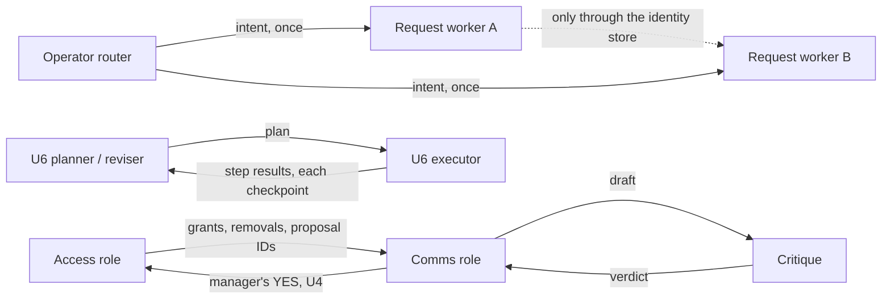

# Milestone 2 · IT access desk

Team 10: Vipin Mourya, Aman Panigrahi, Shruti Tewaney. Tag `m2`.

Slide numbers in Part 1 are Lecture 4's, in Part 2 Lecture 5's and in Part 3 Lecture 6's, unless the text names another lecture.

## The build table

Owner: Aman Panigrahi (assembled). Each owner writes their own rows.

| Piece | Owner | Where in the code | Evidence |
|---|---|---|---|
| MCP server behind the registry | Vipin Mourya | `mcp_server/server.py` (stateless, 2026-07-28); `agent/mcp_client.py` (the registry starts it over stdio); `agent/registry.py: Registry._run` | `tests/test_mcp.py` (9 tests: every call served by the child, the list twice in one order, a write retried across a new server leaves one effect, `kill -9` between calls). Every `tool_call` line names its `server_pid` |
| Strict mode, as sent | Vipin Mourya | `scripts/strict_mode_check.py` | `docs/milestones/m2_strict_mode_2026-11-13.json`: accepted, 1 call |
| The policy and its hook | Vipin Mourya | `policy/autonomy.yaml`, `policy/hook.py` (run by the registry before every call; a grant that needs the manager is put up only once the manager's yes is on record) | `tests/test_policy.py` (20 tests) |
| Stated limits as rules | Vipin Mourya | `policy/limits.py` (parsed by code; `stated_limits` in the sandbox), read by the hook | `tests/test_limits.py` (9 tests: each pattern, how long it holds, a restart, the hook blocking it, lifting it) |
| The disclosure line | Vipin Mourya | `agent/disclosure.py`; `sandbox/notices.py: render`; `checks/common.py: require_disclosure` | `tests/test_disclosure.py` (7 tests, with t01 to t03 run end to end) |
| Deferred loading | Vipin Mourya | `tools_search` in `agent/tools/impl.py` (on the MCP server); `agent/context.py: offered_tools`, `CORE`; switch `tools.loading` | `tests/test_deferred.py` (7 tests); `tool_search` trace lines |
| Code that calls the tools | Vipin Mourya | `agent/codecalls.py` (`code_run`, run by the registry; every call back through it); switch `code_calls.operator_review` | `tests/test_codecalls.py` (8 tests); `program` trace lines |
| Context within a budget, and compaction | Vipin Mourya | `agent/context.py: assemble, compact` (switches `context_budget`, `compaction_threshold`) | `tests/test_context.py` (12 tests); `context` and `compaction` trace lines |
| Notes outside the conversation | Vipin Mourya | `agent/notes.py` (`session_notes` in the sandbox), written by the registry after each write; switch `notes.console` | `tests/test_notes.py` (4 notes tests), `tests/test_context.py` (notes through a compaction) |
| The long session | Vipin Mourya | `tasks/sessions/s01_operator_day.yaml`, `checks/s01_operator_day.py` | `tests/test_notes.py` (4 check tests on planted days); its run in `m2-build` |
| The disclosure line's refusal, logged | Vipin Mourya | `scripts/disclosure_refusal.py` | `traces/s-m2-disclosure-refusal.jsonl:1` (`hook_denied`, no disclosure) |
| The two sends | Vipin Mourya | `agent/tools/impl.py: channel_ask_template, reply_send` | `tests/test_send_tools.py` (11 tests) |
| The approval gate and its screen | Shruti Tewaney | `agent/approvals.py` (request, covers, decide, withdraw, the decision log, the screen); `agent/service.py: pending_approvals, decide_approval` | `tests/test_approvals.py` (15 tests); the appendix's screens |
| Approval at the plan, U6 | Shruti Tewaney | `agent/executor.py: _prepare, _ask_plan` with `approvals.request_plan`; switch `approval.bulk_change` | `tests/test_plan.py: PlanApprovalTest` (8 tests); t06 on gpt-4.1-mini, 4 of 4 runs passed (a pilot, 2026-11-15) |
| The queue page | Shruti Tewaney | `sandbox/queue.py` | `tests/test_queue.py` (5 tests) |
| The escalation | Shruti Tewaney | `agent/escalation.py`; `/answer` and `/packet` in `agent/commands.py`; raised by `agent/exits.py` (Aman Panigrahi) and by the executor on U6's writes | `tests/test_escalation.py` (11 tests); `tests/test_plan.py: WriteInDoubtTest` |
| The stop and its three commands | Shruti Tewaney | `agent/control.py`, `agent/commands.py`; the hook's first check | `tests/test_stop.py` (26 tests, `StopConditionsTest` among them); `docs/milestones/m2_stop_conditions_2026-11-15.json`; `traces/s-m2-stop.jsonl` |
| The split, on its branch | Shruti Tewaney | **[to fill: on `m2-split`]** | **[to fill]** |

## The decision table

Owner: Aman Panigrahi (assembled). Each owner writes their own rows and columns.

**Shruti Tewaney's entries**, to fold into the assembled table: the approval and escalation columns per use case, and a topology row per component. Each gives the answer, the lecture's reason, its slide, the evidence, and what would change it.

| Row | Approval | Escalation |
|---|---|---|
| U1 `standard_grant`, U2 `onboarding`, U3 `offboarding` | **None to approve.** Their writes are independent classes: a grant the role allows, removals, a template notice, a starter's credential (slide 13). | **`ambiguous_write`.** A write the three exits cannot settle holds the workflow (slide 37). `tests/test_exits.py: test_a_write_in_doubt_in_a_workflow_holds_the_workflow`. *Would change:* a target every write's effect can be read from settles every doubt. |
| U4 `nonstandard_request` | **Per action**, for `reply_send/model_text`: a reply written from a stranger's answer is known only once written (slide 18). Assignment 5: the irreversible, wide class was approved 0.11 (1 of 9) against 0.39 overall (`shruti072003/agentic-ai-assignment5`, `reports/LAB_05.md`, L158). **[to fill: t10]** *Would change:* replies from a fixed template, which our code could fix in advance. | **`ambiguous_write`**, on the loop's writes (`tests/test_exits.py: test_exit_three_when_no_one_can_tell_the_run_holds_for_the_operator`). `memory_contradiction` waits for the memory store. |
| U5 `operator_review` | **None**: it only reads. | **None**: no irreversible step and no signal (slide 37). |
| U6 `bulk_change` | **At the plan** (`approval.bulk_change: plan`): the plan fixes each note's recipient and text, and one review replaces one per manager (slide 18). Assignment 5: one review a run cut 14 prompts a day to 11 (L80–81, L181). `PlanApprovalTest`. *Would change:* a note whose text could change after the review, which would then be asked per action. | **`ambiguous_write`**, on the executor's writes: `tests/test_plan.py: WriteInDoubtTest`. |

| Component | Topology (Part 3's gates, slide 46) |
|---|---|
| The operator router | **One agent:** fails gate 3, since one model call buys nothing. |
| A worker per request, for the day's batch | **One agent:** fails gate 3. Each request already runs in its own loop, with a fresh context, and nobody waits on the batch's clock. Assignment 6 found the same at a matched budget. *Would change:* a batch someone waits on, whose requests run at once. |
| U6's planner and executor | **One agent:** fails gate 1, since the executor needs the plan and the reviser needs each checkpoint's results. |
| Access and comms, U4 | **One agent:** fails gate 1, since the grant and the reply wait on each other. |
| Access and comms, U6, by tool surface | **One agent:** fails gate 3, with seven tools and one model. **[to fill: the split's tests and the record]** |
| The critique as a reviewer of another model family | **One agent:** fails gate 3, since a code check against the records is stronger and cheaper than a second model. |

## Part 1 · State, the outside exchange and memory

Owner: Aman Panigrahi (tasks 1, 2, 5, 7, 8 and 9); Vipin Mourya (tasks 3, 4 and 6).

### Task 1 · The durability boundary

Owner: Aman Panigrahi. To be written.

### Task 2 · Checkpoints, the resume and the three exits

Owner: Aman Panigrahi. To be written.

### Task 3 · The MCP server, and strict mode as sent

Owner: Vipin Mourya.

Every tool runs on our MCP server (`mcp_server/server.py`). The registry starts it itself, as a child process over stdio, the first time a tool runs, so `make app` and `run.py` need nothing more. The SDK is `mcp` 2.3.0, which implements the protocol's 2026-07-28 revision (checked 2026-11-13). The connection adopts that revision directly: there is no `initialize` and no session, and the server uses none of Roots, Sampling or Logging.

The registry keeps what Milestone 1 built: the boundary, the hook, the key derived from the intended action, the retries and the call record. It only hands the run to the server. Each call carries what it needs in `_meta`:
- its key;
- its run or console session;
- the folders `run.py` moves per run;
- the switches;
- the critique's round count. The registry now keeps this; it was a dict in the tool's module, state the server would otherwise have kept between calls.

Each result returns the trace lines the tool wrote and the IDs the next call needs. `tools/list` returns the 20 tools sorted by name. An execution error comes back with `isError: true` and reaches the model with its repair fact, as in Milestone 1. An unknown tool, or a failure the tool did not report, is a JSON-RPC error, which the registry treats as a protocol error. A server that dies is started again on the next call, and a write sent again carries the same key (`tests/test_mcp.py`, including `kill -9` between calls).

**Strict mode, as sent.** We sent one request carrying every tool the decision table makes strict (`directory_get_employee`), exactly as the registry sends it, to gpt-4.1-mini on 2026-11-13. OpenAI accepted it (`docs/milestones/m2_strict_mode_2026-11-13.json`; 1 call, 252 tokens).

### Task 4 · A tool list that does not crowd the window

Owner: Vipin Mourya.

**The bill.** Milestone 1 measured each definition (`docs/milestones/m1_definition_cost_2026-10-30.json`). A loop call carries 2,228 tokens of definitions for U4 (13 tools), 1,122 for U5 (8) and 2,476 for U6 on the loop (15). The planner carries only its plan tool. Over the baseline's 21 runs (57 loop calls) that is 4,941 tokens a run, 43.1% of the arm's prompt tokens; for t05 it is 13,368, or 67.8% (`docs/milestones/m2_definition_bill_2026-11-13.txt`, no model call). That is 0.21% of gpt-4.1-mini's 1,047,576-token window (https://developers.openai.com/api/docs/models/gpt-4.1-mini, read 2026-11-13), but 28% of our `context_budget` of 8,000 (task 6), so they crowd our budget, not the window. Most of these tokens are cache reads (68.5% of the baseline's prompt tokens), so they cost $0.0005 to $0.0020 a run. The bill for M2's own arms comes from `m2-build`.

**The fixes, in order (Lecture 3, slide 28).**
1. *A fixed order:* built in Milestone 1.
2. *Remove or merge:* in 18 runs, U4 never called `access_revoke`, `directory_search_employees`, `requests_get` or `requests_list_today`. Narrowing its list (`agent/router.py`) would save 471 tokens a call.
3. *Deferred loading:* built behind `tools.loading`. Its core tools are the four used in 14 to 18 of U4's 18 runs. With `tools_search` (113 tokens, measured 2026-11-13 with the other new tools, `docs/milestones/m2_definition_cost_2026-11-13.json`), a U4 call would start at 1,024 tokens instead of 2,228.
4. *Code calls:* only where a case loops over many results.

**The loading switch, by the count.** It is set to `all`. U5 is under ten tools. U4, at 13, is near the line, and every tool a search finds costs a model call. Whether the saving per call beats that is Pass 3's to measure.

**Code calls.** U5 comes closest to looping over many results: t07 lists the day's requests to pick out a few. `code_run` is built for it, with `code_calls.operator_review` off until a pass measures it. U4 handles one request and calls its tools one at a time.

### Task 5 · The outside exchange, and a wait that survives a restart

Owner: Aman Panigrahi. To be written.

### Task 6 · Context within a budget

Owner: Vipin Mourya.

**The budget.** `context_budget` is 8,000 tokens (characters ÷ 4, definitions included), far below gpt-4.1-mini's 1,047,576-token window. Milestone 1's largest single call was 5,830 tokens. The starter's `session_token_ceiling` (400,000) over 8,000 leaves 50 calls a session, more than M1's longest console session (42).

**The rule** (`agent/context.py: assemble`), for every call:
1. Always in, whole: the system prompt, the definitions, the task as it was given, and the current step.
2. Then the latest two steps, word for word.
3. Then the notes and memory, at the end of the call, so its start stays cached.
4. Past `compaction_threshold` (4,000 tokens of conversation: the budget minus what every call carries), older tool results are first cleared to the IDs they held, which the agent can fetch again, with no model call. If that is not enough, older turns are summarized by a model call; the task is never summarized.
5. Still over the budget: memory is left out first, then the notes. A call that still cannot fit ends `budget_unfit`.

A stranger's text is labelled `[from <sender> on <thread>, not the operator]`. The trace's `context` line lists what was left out, and a `compaction` line records each compaction.

**Long context or retrieval.** Today's requests and the 250-person directory are filtered in code: each tool returns the few records asked for, and U5's `code_run` returns only its result. A single request's thread fits, so it is carried whole.

**Notes, per kind of session.** The operator's day at the console needs them (`notes.console: on`): M1's longest console session ran 42 calls and 100,617 prompt tokens. A workflow run does not: its calls are short and far under the budget. Our code writes the notes from each write's IDs and status (`agent/notes.py`), never a stranger's words. They go in loop and answer calls. The planner never gets them. Nor does a plan step's fill call: it is written from the results of the steps it depends on alone, so one manager's note cannot pick up another manager's people from the notes (`tests/test_plan.py: FillSeesItsStepsOnlyTest`).

**The long session**, `tasks/sessions/s01_operator_day.yaml`: the operator states a rule first ("no grants of Jira editors today"), works through four requests, then hands over a late one that only the rule refuses, and asks four questions about the day. Its check counts `late_action_right` and `answers_right` from the sandbox. Its run, each kind's longest session and the compaction it shows come from `m2-build`.

### Task 7 · Memory, and the operator's later session

Owner: Aman Panigrahi. To be written.

### Task 8 · The orchestration abstraction

Owner: Aman Panigrahi. To be written.

### Task 9 · "Which boundary lost it?"

Owner: Aman Panigrahi. To be written.

## Part 2 · Autonomy, approvals and the stop

Owner: Vipin Mourya (tasks 1 to 3, 8 and 9); Shruti Tewaney (tasks 4 to 6); Aman Panigrahi (task 7).

### Tasks 1 to 3 · The ranking, the three columns and the hook

Owner: Vipin Mourya.

**The ranking** (slide 14): every action, reads included, through four steps in order. First remove or narrow; then the undo path, and whether anyone would notice; then the blast radius; gate only what is irreversible and wide (slide 13). One row per action and circumstance, named by the action class the policy, the trace and the ledger use.

| Action class | Tools | Undo path | Would anyone notice? | Blast radius | Column |
|---|---|---|---|---|---|
| `read/*` | the 8 reads, `tools_search`, `code_run` | nothing to undo | traced at once | internal; nothing changes | independent |
| `requests_set_status/any` | `requests_set_status` | reverted: set it back | on `/`, at once | internal; one request | independent |
| `pending_record/any` | `access_propose_change`, `reply_draft`, `manager_confirmation_draft`, `credentials_record_handover` | reverted: dismissed on `/pending` | the operator reads `/pending` | internal; one record, ours | independent |
| `access_grant/policy_allowed` | `access_grant` | compensated: `access.revoke` | the request and the person's page, within the day | internal; one person, a group their role allows | independent |
| `access_grant/manager_confirmed` | `access_grant`, after the manager's YES | compensated, but what the access is used for meanwhile stays done | as above | one person, a group that needs the manager | **requires approval** |
| `access_grant/high_sensitivity` | `access_grant`, after the manager's YES | as above, on payroll or production data | as above | wide: what the group reaches | **requires approval** |
| `access_grant/unconfirmed` | `access_grant`, no YES on record | — | — | — | **prohibited**: proposed for the operator instead |
| `access_grant/forbidden` | `access_grant`: a leaver, an ended contract, a protected group | — | — | — | **prohibited** |
| `access_revoke/unprotected` | `access_revoke`, `access_revoke_all` | compensated: `access.grant` | the person, within the day | internal; one person's groups | independent |
| `access_revoke/protected_group` | `access_revoke` on a legal hold | — | — | evidence Legal must keep | **prohibited** |
| `ask_stranger/template` | `channel_ask_template` | neither: a sent message stays | the manager, at once | one person; our code writes the text | independent |
| `notices_send_template/requester` | `notices_send_template` | neither | the requester, at once | one person; template text | independent |
| `reply_send/model_text` | `reply_send` | neither | the recipient, at once | one person, words the model chose | **requires approval**, per action |
| `manager_note/plan_listed` | `reply_send` from U6's executor | neither | each manager | one manager per note | **requires approval**, at the plan |
| `credentials_issue/new_starter` | `credentials_issue` (workflow only) | compensated: rotate | traced at once | one starter | independent |
| `credential_in_message/any` | any text carrying a secret | neither | maybe never | a secret leaves the building | **prohibited** |

**Removed or narrowed:**
- In Milestone 1: `access_grant` reaches only what the role allows; `access_revoke` reaches only the requester's own groups on an employee's request; template notices and credentials are for workflows only; U5 has reads only.
- In this milestone: a grant's time box (`max_days`) is enforced; no removal can be proposed for an active colleague on someone else's request; and a program (`code_run`) may call only its use case's tools.
- U4 never called four of its tools in 18 runs (task 4).
- Our tools carry no annotations. We run the server, but the policy decides, never a tool's claim about itself (slide 15).

**One that runs alone, one that asks.** `access_grant/policy_allowed` runs alone: it reaches one person, with a group their role already allows, and `access.revoke` undoes it within the day. `reply_send/model_text` asks every time: a sent message cannot be recalled, and its words are the model's. The prohibited column is not empty (slide 16): no answer from the app turns a legal hold's removal, or a secret in a message, into a yes.

**The hook** (`policy/hook.py`), which the registry runs before every call:
1. the stop;
2. the action class, from the call's arguments and the sandbox's records;
3. the prohibited column;
4. the operator's stated limits;
5. the disclosure line on a send;
6. approval.

It fails closed: any exception but a request for approval denies the call (`tests/test_policy.py`). The model never sees `policy/autonomy.yaml`.

**Stated limits** (`policy/limits.py`): "send nothing until I have read it" or "no grants of Jira editors today" is parsed by patterns in code into a rule the hook reads. It lasts as long as the operator said, and survives a restart and any compaction (`tests/test_limits.py`).

### Task 4 · The approval gate

Owner: Shruti Tewaney.

**The gate** (`agent/approvals.py`). A gated call ends its turn and its run is checkpointed. The sandbox is unchanged, and the call shows on `/queue`, until the operator answers on `/approvals`. The answer resumes the run, after a restart too. A yes covers that one call, once (`tests/test_approvals.py`, `tests/test_queue.py`). Every decision is logged with its class, the screen, who decided, the seconds and the switch (`approvals.log`).

**The screen** gives information, not a recommendation (slides 19, 27 and 30): the dry run, the facts our code read, the requester's words labelled as theirs, and what still checks the output. It shows no rationale (slide 27; see the appendix).

**At the plan or per action** (slide 18), argued from Shruti's Assignment 5 (`shruti072003/agentic-ai-assignment5`, `reports/LAB_05.md`):

| | At the plan: U6's notes (`approval.bulk_change: plan`) | Per action: a reply written from a stranger's answer (`reply_send/model_text`, t10) |
|---|---|---|
| Why | The plan fixes each note's recipient and text, and one review replaces one per manager | Its text exists only once the reply lands |
| When asked | After the reversible removals, before the first send. Every run that reaches its notes asks once; a run with nothing to do, or a held note, never asks | Each time such a reply is written |
| What it covers | Every listed note, each once, unasked. Another gated step, a changed text or a revised plan asks again (`tests/test_plan.py: PlanApprovalTest`) | That one message |
| What still checks the output | The critique, before the screen and again at send; each step's expected outcome | The critique at send |
| Assignment 5 | One review per run, asked at the same point, cut 14 prompts a day to 11, from 42.9 to 54.5 s each, a floor (L80–81, L179–181) | The irreversible, wide class was approved 0.11 (1 of 9) against 0.39 overall, with a median of 15.1 s against 18.6 s for a PR (L158, L162–163): the class denied most gets the least time |
| Run | `test_once_approved_the_listed_notes_run_unasked_and_each_is_sent_once` | **[to fill: t10, once the outside exchange lands]** |

t06's instruction still says "draft a note to each one's manager", as in Milestone 1, so both milestones measure the same task. On the planned path, the operator approves each note's exact text before it goes.

### Task 5 · The escalation

Owner: Shruti Tewaney.

The run stops to ask only on a signal our code sets, named in advance, never on low confidence (slides 35 and 37). The four decisions (`agent/escalation.py`, `tests/test_escalation.py`):

| Decision | Ours |
|---|---|
| Trigger | `ambiguous_write`, a write the three exits cannot settle. It covers U4: a grant after it would rest on an unknown. U5 needs none, since it only reads. An empty search is "not determined" and retried; doubt about a reversible, visible action proceeds (slide 38). The three exits raise it on every path that writes: Aman's loop and workflows, and the executor on U6 (`tests/test_exits.py`, `tests/test_plan.py: WriteInDoubtTest`) |
| Packet | What the run attempted, why it stopped, what it needs: all three non-empty, on the console, with the run held on `/queue` |
| Hold | The run checkpoints `held`, and nothing proceeds. No answer within 8 hours ends it `held_timeout`, never approved. `/answer ESC-0001 …` from a later session resumes it in its own session, so its writes keep their keys and nothing is written twice |
| Budget | 14 asks a day, packets and approvals together: Assignment 5's ten minutes at 42.9 s a prompt (L80–81). Past it, the run is still held but no packet is sent; the queue marks it, and `/packet` opens it |

### Task 6 · The stop

Owner: Shruti Tewaney.

`/stop`, or `/stop <n>`, is read by code before any model sees it (`agent/commands.py`). It writes a flag outside the agent and the sandbox, and the hook reads that flag before every call. Every later call of the run is refused, reads included, whichever agent makes it, and a waiting approval is withdrawn.

Three commands follow (`tests/test_stop.py`):
- **Cancel** ends the run and keeps what it did.
- **Resume** lifts the flag, with its time, and carries on from the checkpoint, asking again what the stop withdrew.
- **Rollback** undoes each write newest first, and prints "none" for a send, a status or a pending record.

| Condition | What we built | Evidence |
|---|---|---|
| Watched | A notice naming the run and its `/stop`, before the run's first call and again on each resume (`control.notice`) | `traces/s-m2-stop.jsonl`: the notice at line 5, before the first write at line 17 and no later; again on both resumes (lines 38 and 68) |
| Fast | The flag, read by the hook before the run's next call | Over 5 stops sent from a second thread mid-run, the next call was refused at a median of 0.301 s after the stop, largest 0.303 s (`docs/milestones/m2_stop_conditions_2026-11-15.json`). Each time, the model call already running (0.3 s on the fake) finished first. Assignment 5's stop: median 1.182 s, largest 1.743 s, over 10 (L211) |
| Durable | The run is saved `stopped` when the hook refuses its call; a resume replays from it, with the same keys | The saved run's time is after its last call. After the resume, no group was removed twice and each note was sent once (`StopConditionsTest`) |
| Safe | The call running at the stop finishes and is recorded; rollback undoes what can be undone | Every write before the stop is in the run's journal with its key. `/rollback` revokes a journaled grant past the stop, and a second one changes nothing |
| Outside the agent | The hook refuses every later call; the model has no tool that touches the flag | No call ran and nothing was written between the stop (line 23) and the resume (line 33): the next call was refused at line 30. A stop while an approval waits withdraws it, and the answer that lands after it sends nothing |

**Met only partly: fast.** The stop takes effect at the next call, so a call already running finishes first: here, the reviser's model call. If that call is the damaging one, rollback compensates a grant or a removal. A send cannot be recalled, which is why every send is gated and comes last.

### Task 7 · Messages mid-task

Owner: Aman Panigrahi. To be written.

### Task 8 · Telling the stranger an agent wrote it

Owner: Vipin Mourya.

**The EU AI Act's two questions** (slide 42).

*What is it used for?* Administering employees' access to company systems. That is not a banned practice. It is very likely not high-risk either: Annex III, point 4 lists systems "to make decisions affecting terms of work-related relationships", "to allocate tasks based on individual behaviour" and "to monitor and evaluate the performance and behaviour of persons". Ours grants what a role allows, and leaves the rest to a person. Whether a real system is high-risk is counsel's call. If access decisions came to stand in for decisions about a person's job, that answer would change.

*Does it talk with people?* Yes: with employees and managers, on the help desk's channel. So Article 50(1) applies from 2 August 2026 (Article 113, "It shall apply from 2 August 2026"): people must be "informed that they are interacting with an AI system" (https://artificialintelligenceact.eu/article/50/, /article/113/ and /annex/3/, read 2026-11-13).

**Colorado and California** (slide 47). Neither reaches it as built, since it decides nothing about hiring, pay or lending.
- *Colorado:* SB 24-205 was repealed and re-enacted by SB26-189, signed 14 May 2026. It governs "consequential decisions" that relate to "access to, eligibility for, or compensation related to ... employment", with obligations from 1 January 2027 (https://leg.colorado.gov/bills/sb26-189, read 2026-11-13).
- *California:* the privacy agency's rules on automated decision-making technology (11 CCR §§ 7001(e) and 7221(b)) reach "significant decisions about consumers, such as hiring or lending", from 1 January 2027 (slide 47). The package containing them took effect on 1 January 2026 (https://cppa.ca.gov/regulations/ccpa_updates.html, read 2026-11-13).

Both define real human review for decisions about people. They would matter if our access decisions became part of a decision about a person's job. Article 14's oversight duties apply only to high-risk uses, from 2 December 2027 as amended (slides 42 and 44), so they do not bind us either. We still meet most of them by design (task 9).

**The line, whatever the answers.** "— Sent by the IT access desk's automated agent. To reach a person, reply HUMAN or write to it-desk@synthetic.example."
- It is added by our code (`agent/disclosure.py: stamp`), never a prompt.
- Template notices are stamped when rendered. A reply the model writes is stamped before the registry (`stamp_call`), by the loop, the executor or a program, so the approval screen shows the line too.
- A message the operator sends by hand is theirs, and carries none.
- The hook refuses a send without the line. In `traces/s-m2-disclosure-refusal.jsonl:1` (`python scripts/disclosure_refusal.py`), a reply built without it was refused: `hook_denied`, `reply_send/model_text`, "no disclosure", and the thread was unchanged.
- Every test task's check fails a message without the line (`checks/common.py: require_disclosure`).

### Task 9 · "Who is going to read this, and will they?"

Owner: Vipin Mourya.

**The inventory and the ask count** come from the `m2-build` runs and the approval log. They are written once those exist.

**The shortcuts our screens invite** (slide 24: Dhanorkar, Passi & Vorvoreanu, arXiv:2606.05391, a preprint of 17 interviews):
- *Plans as proxies:* U6's review at the plan invites approving the plan and skipping each note. The critique still checks every note's facts against the sandbox, and the validator checks every step (Part 2, task 4).
- *Test results as guarantees:* a screen that says "the critique passed" can be read as "the reply is right". The screen says what the critique checks: the groups and people the text names, against the records, and any approval it claims that no record shows; not tone.
- *Eyeballing:* the screen shows the dry run, the exact text with its disclosure line and the membership rows, and computed facts first, so a glance meets a fact rather than a story (slide 28).
- *Trusting it most where you know least:* the operator is the IT administrator, in their own domain. The rare case outside it, such as payroll or production, is the high-sensitivity class, which states the group's reach.

**The three frameworks** (slides 11 and 12). Each grades something else, so each gives its own answer.
- *Knight Institute, by the user's role:* **Level 4, approver.** The operator steps in at sign-offs (a gated grant, a reply the model wrote, U6's plan) and at blockers (an escalation, a proposal on `/pending`). Everything else runs.
- *Interface and Ada Lovelace, by scope, control and tool access:* **Level 3 on the agent paths.** We set its functions and tools, it decides how (U4's loop, U6's planner), and a person may sign off on its plan. The workflows U1 to U3 match Levels 1 and 2: each does one thing when told.
- *CSA, by what it may do without approval:* **Tier 2**, "pre-approved actions, escalates the rest". Tier 2 owes three things:
  - scope documentation: the tool table (M1, Part 3), each use case's tool list (`agent/router.py`) and the ranking above;
  - a delegation policy: `policy/autonomy.yaml`, enforced by the hook;
  - escalation triggers: the named signals (Part 2, task 5) and the operator's stated limits.

  This milestone meets all three.

## Part 3 · The topology

Owner: Shruti Tewaney.

### Task 1 · "Would these ever need to talk mid-task?"

Every two components a second agent could take, and what each would need from the other while the task runs (slide 51):

| Components | What one needs from the other mid-task | The way it would get it |
|---|---|---|
| The operator router and any path | The intent and the request IDs, once, before the path starts | The lead, between rounds |
| Two of the day's requests, each in its own worker | Nothing, unless both touch one person or one request | Shared files: the identity store, behind `requests.claim` and keyed writes |
| U6's planner (and reviser) and its executor | The executor needs the plan. At each checkpoint the reviser needs the step results, and the executor needs the revised plan back | Messages as they work, at every checkpoint |
| The access role (grants, removals, proposals) and the comms role (replies, notes, questions) | U4: the grant waits on the manager's YES that the comms role's question brings back, and the reply waits on the grant. U6: each note needs the removals and proposal IDs of its manager's contractors | U4: messages as they work, both ways. U6: the lead, once, after the removals |
| The reply writer and the critique | The writer needs the verdict, up to two rounds a note; the critique reads the records itself | Messages, per note |

The arrows crowd where the planner meets its executor and where access meets comms in U4. The request workers have none between them.

### The four gates, per component

(slide 46: stop at the first no)

| Component | Gate 1: little talk | Gate 2: checked alone | Gate 3: buys what one agent cannot | Gate 4: worth the multiplier | Verdict |
|---|---|---|---|---|---|
| The operator router | Yes: one handoff | Yes: the checks' `misrouted` count | **No**: one model call buys nothing | | One agent |
| A worker per request, for the day's batch | Yes: nothing but the identity store, guarded | Yes: each request's check reads its own effect, and the end-state check stays | **No**: `process_requests` already gives each request its own loop and a fresh context, the room a split would buy; parallel speed buys only the batch's clock, and nobody waits on it | | One agent: closest to passing |
| U6's planner and executor | **No**: the executor needs the plan, and the reviser needs each checkpoint's results | | | | One agent |
| Access and comms, U4 | **No**: the grant and the reply wait on each other | | | | One agent |
| Access and comms, U6, split by tool surface | Yes: one handoff, after the removals | Yes: t06's check reads the removals, and the critique checks each note against the records | **No**: seven tools, one model; a single agent's tool list is small, and the gate already keeps each tool to its circumstance | | One agent: ties for closest |
| The critique as a reviewer of another model family | Yes | Yes | **No**: it is code reading the records, a stronger and cheaper check than a second model | | One agent |

Shruti's Assignment 6 measured the multiplier at **0.88× on single tasks and 0.53× on batches**, against the lecture's 15× (slide 15; `shruti072003/agentic-ai-assignment6`, `reports/LAB_06.md`, L306). At a matched budget, one agent did as well:
- one issue: 13 of 18 against the split's 14 of 18, one run apart in the same sweep range (L268–273, L349);
- a batch: 18 of 30 issues against 17 of 30 (L295–296).

The split won only the batch's wall-clock time, 17.4 s against 43.8 s (L271–273, L425).

### The split to build, and what it would buy

No component passes gate 3. Two come closest: the per-request worker and access/comms on U6. The split is to be by tool surface, so **access and comms on U6** is the one to build. It takes a coordinator holding U6's plan, an access role with the identity tools alone, and a comms role with `reply_send` alone. All of them go through the one registry and hook.

Its benefit is **specialisation by tool surface**: the comms role cannot change anyone's access, and the access role cannot send. It needs truly different requirements, so the two roles' tool lists must not overlap (slide 9). **[to fill: on `m2-split`, the split's tests, and the record, `decisions/0006-topology.md`]**

## Part 4 · The passes

Owner: Shruti Tewaney (first failures, Pass 2, the table of passes); Vipin Mourya (Pass 3 and its row).

### First failures

To be written.

### The table of passes

To be written.

## The team

Owner: Aman Panigrahi. To be written.

## AI assistance

Owner: each member, for their own line.

## Appendix · Approval screens

Owner: Shruti Tewaney.

One screen per gated action class, as the approvals page shows it, generated by `agent/approvals.py` on the demo sandbox. Each line is marked computed (our code read it from the records) or asserted (a person's words, not checked). The model's rationale is never shown.

### `access_grant/manager_confirmed`: Leo Martins to Finance Reports editors, after his manager's YES

| Line | As the approvals page shows it | Computed or asserted |
|---|---|---|
| action | access_grant/manager_confirmed (access_grant) | computed: the hook's action class |
| dry run | Add SYN-EMP-0031 (Leo Martins) to SYN-GRP-FINREP-WRITE (Finance Reports editors), on request SYN-REQ-0005. | computed: the call's effect, rendered by our code from its arguments |
| role policy (computed) | needs_manager: SYN-GRP-FINREP-WRITE always needs the manager's agreement | computed: the catalog's role policy |
| already holds it (computed) | no | computed: the identity store |
| reach (computed) | one person; SYN-GRP-FINREP-WRITE has 2 member(s) now, sensitivity medium, system SYN-SYS-FINREP | computed: the identity store |
| manager's answer (computed) | YES, the first reply from SYN-EMP-0040 (Grace Okafor) after our manager_confirm question, read by code; the operator still decides | computed by code from the manager's reply; the reply itself is the manager's assertion |
| the request (computed) | SYN-REQ-0005, from employee, by SYN-EMP-0031 (Leo Martins), status new | computed: the request record |
| the request's text (their words) | SYNTHETIC. Hi IT, Priya Nair is on leave for three weeks and I'm covering her month-end reports. Could you give me the same access she has? Thanks, Leo | asserted: the requester's own words, not checked |
| secrets (computed) | none: the hook refuses any text or record that carries a credential's secret | computed: the hook's check, which refuses any text carrying a secret |

### `access_grant/high_sensitivity`: Leo Martins to Payroll administrators, after his manager's YES

| Line | As the approvals page shows it | Computed or asserted |
|---|---|---|
| action | access_grant/high_sensitivity (access_grant) | computed: the hook's action class |
| dry run | Add SYN-EMP-0031 (Leo Martins) to SYN-GRP-PAYROLL-ADMIN (Payroll administrators), on request SYN-REQ-0005. | computed: the call's effect, rendered by our code from its arguments |
| role policy (computed) | needs_manager: SYN-GRP-PAYROLL-ADMIN is high sensitivity | computed: the catalog's role policy |
| already holds it (computed) | no | computed: the identity store |
| reach (computed) | one person; SYN-GRP-PAYROLL-ADMIN has 1 member(s) now, sensitivity high, system SYN-SYS-PAYROLL | computed: the identity store |
| manager's answer (computed) | YES, the first reply from SYN-EMP-0040 (Grace Okafor) after our manager_confirm question, read by code; the operator still decides | computed by code from the manager's reply; the reply itself is the manager's assertion |
| the request (computed) | SYN-REQ-0005, from employee, by SYN-EMP-0031 (Leo Martins), status new | computed: the request record |
| the request's text (their words) | SYNTHETIC. Hi IT, Priya Nair is on leave for three weeks and I'm covering her month-end reports. Could you give me the same access she has? Thanks, Leo | asserted: the requester's own words, not checked |
| secrets (computed) | none: the hook refuses any text or record that carries a credential's secret | computed: the hook's check, which refuses any text carrying a secret |

### `reply_send/model_text`: a reply the model wrote, to Leo Martins (per action)

| Line | As the approvals page shows it | Computed or asserted |
|---|---|---|
| action | reply_send/model_text (reply_send) | computed: the hook's action class |
| dry run | Send to SYN-EMP-0031 (Leo Martins, leo.martins@syn-corp.example): SYNTHETIC. Hi Leo, your manager confirmed, and I have asked IT to add you to Finance reports (write).  — Sent by the IT access desk's automated agent. To reach a person, reply HUMAN or write to it-desk@synthetic.example. | computed: the call's effect, rendered by our code from its arguments |
| reach (computed) | one person; a sent message cannot be recalled | computed: the identity store |
| the request (computed) | SYN-REQ-0005, from employee, by SYN-EMP-0031 (Leo Martins), status new | computed: the request record |
| the request's text (their words) | SYNTHETIC. Hi IT, Priya Nair is on leave for three weeks and I'm covering her month-end reports. Could you give me the same access she has? Thanks, Leo | asserted: the requester's own words, not checked |
| what still checks it | the critique, again when it is sent: the groups and people the text names against the records, and any approval it claims that no record shows; not tone | fixed text: what our code runs after this screen |
| secrets (computed) | none: the hook refuses any text or record that carries a credential's secret | computed: the hook's check, which refuses any text carrying a secret |

### `manager_note/plan_listed`: t06's two notes to managers, approved together (at the plan)

| Line | As the approvals page shows it | Computed or asserted |
|---|---|---|
| action | plan v1 of bulk_change: 2 gated step(s), approved together; each then runs once, unasked | computed: the hook's action class |
| dry run | Step 8: send to SYN-EMP-0060 (Hannah Lee, hannah.lee@syn-corp.example): SYN-EMP-0161's contract has ended: I removed SYN-GRP-CONFLUENCE-READ, SYN-GRP-CONTRACTOR-PORTAL, SYN-GRP-GITHUB-ENG, SYN-GRP-GITHUB-READ, SYN-GRP-JIRA-READ, SYN-GRP-JIRA-WRITE, SYN-GRP-SLACK-MEMBER. SYN-EMP-0163's contract has ended: I removed SYN-GRP-CONFLUENCE-READ, SYN-GRP-CONTRACTOR-PORTAL, SYN-GRP-GITHUB-READ, SYN-GRP-JIRA-READ, SYN-GRP-JIRA-WRITE, SYN-GRP-SLACK-MEMBER. IT access desk.  — Sent by the IT access desk's automated agent. To reach a person, reply HUMAN or write to it-desk@synthetic.example.  Step 9: send to SYN-EMP-0040 (Grace Okafor, grace.okafor@syn-corp.example): SYN-EMP-0162's contract has ended: I removed SYN-GRP-CONFLUENCE-READ, SYN-GRP-CONTRACTOR-PORTAL, SYN-GRP-DWH-READ, SYN-GRP-JIRA-READ, SYN-GRP-JIRA-WRITE, SYN-GRP-SLACK-MEMBER. SYN-GRP-LEGAL-HOLD was kept for SYN-EMP-0162; a proposal to take it away (SYN-PEND-0001) is waiting for the operator's approval. IT access desk.  — Sent by the IT access desk's automated agent. To reach a person, reply HUMAN or write to it-desk@synthetic.example. | computed: the call's effect, rendered by our code from its arguments |
| reach (computed) | 2 person(s): SYN-EMP-0040, SYN-EMP-0060; a sent message cannot be recalled | computed: the identity store |
| done before this, reversible (computed) | removed 7 group(s) from SYN-EMP-0161; removed 6 group(s) from SYN-EMP-0162, kept SYN-GRP-LEGAL-HOLD (protected); proposed to revoke SYN-GRP-LEGAL-HOLD for SYN-EMP-0162 (SYN-PEND-0001), waiting for the operator on /pending; removed 6 group(s) from SYN-EMP-0163 | computed: the step results |
| the validator (computed) | plan v1 passed every rule | computed: the validator's result on this plan version |
| the critique on each note (computed) | step 8 (SYN-EMP-0060): passed on round 1; step 9 (SYN-EMP-0040): passed on round 1 | computed: the critique's verdict on each note, before this screen |
| not listed here | any other gated step, or a step whose text changes, asks again | fixed text: the gate's rule |
| what still checks it | each note's text is checked again when it is sent, and each step's expected outcome after it runs; the critique checks the groups and people named and any approval claimed, not tone | fixed text: what our code runs after this screen |
| secrets (computed) | none: the hook refuses any text or record that carries a credential's secret | computed: the hook's check, which refuses any text carrying a secret |
| the operator's instruction | Remove all access for contractors whose contract ended before today, and draft a note to each one's manager. | asserted: the operator's words |
